---

## `$ fastfetch`

## `$ cat tech-stack.yaml`

| `jose@mtl:~$ cat tech-stack.yaml` | |
| --- | --- |
| `├─ ☁ systems:`  `Linux · Bash · Docker` | `├─ ⚙ ci_cd:`  `GitHub Actions · Git` |
| `├─ ✦ languages:`  `TypeScript · JavaScript · Python · Java · Go · C# · SQL` | `╰─ ⌁ frameworks:`  `Node.js · React · .NET` |

---

## `$ tail -n 5 ~/now.log`

`now: preparing for the LFCS (Linux Foundation) · Linux, DevOps and cybersecurity enthusiast · self-hosting on my own VPS (Docker, Caddy, GitHub Actions deploys) · status: learning in public`

---

## `$ connect --socials`

---

Montréal, Québec · @JoseJimenez-M
